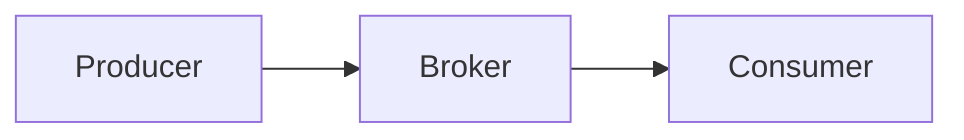

# Study File Templates

Replace everything in `<angle brackets>`. Drop sections the source doesn't need (for example the run flag constant when nothing is dangerous).

## Code study file (Kotlin skeleton)

Adapt the comment syntax, naming and entry point to the target language. The structure stays the same.

````kotlin
/*
 * <Page title> - study notes
 * Source: <URL>
 *
 * Setup (not included here, add it to your own project):
 *
 *   // build.gradle.kts
 *   repositories { mavenCentral() }
 *   dependencies {
 *       implementation("<group>:<artifact>:<version from the page>")
 *   }
 *
 * Optional: <run flags, e.g. VM option -Dkotlinx.coroutines.debug and what it shows>.
 *
 * Each example is a function. `main()` at the bottom runs them all in order.
 * The expected output is written at the end of each example function.
 * <Note on output that can vary between runs, if any.>
 */

import <imports used by the examples>

/** Set to `true` to run example <N> (<what it does>). It may <risk>. */
const val RUN_<NAME>_DEMO = false

// ---------------------------------------------------------------------------------------------
// 1. <Page section heading>
// ---------------------------------------------------------------------------------------------

/**
 * <One to three lines on the concept this example shows.>
 */
suspend fun example01<Topic>() {
    <doc example code, kept as written>

    // Expected output:
    // <line 1>
    // <line 2>    (after ~1 s)
}

<helper functions from the doc example>

// ---------------------------------------------------------------------------------------------
// <N>. <Page section heading>
// ---------------------------------------------------------------------------------------------

/**
 * <Concept.>
 *
 * WARNING: <how it fails, e.g. may throw OutOfMemoryError>. Disabled by default,
 * see [RUN_<NAME>_DEMO].
 */
fun example<NN><DangerousTopic>() {
    <doc example code>
}

/* -- <Why this does not compile> --
<doc's non-compiling snippet>
*/

// ---------------------------------------------------------------------------------------------
// Entry point
// ---------------------------------------------------------------------------------------------

suspend fun main() {
    println("=== 1. <Title> ===")
    example01<Topic>()

    println("\n=== 2. <Title> ===")
    example02<Topic>()

    if (RUN_<NAME>_DEMO) {
        println("\n=== <N>. <Title> ===")
        example<NN><DangerousTopic>()
    }
}

/*
 * Key takeaways
 * - <Takeaway 1>
 * - <Takeaway 2>
 */
````

### Entry point and naming in other languages

| Language | Function name | Entry point | Expected output comment |
|----------|---------------|-------------|-------------------------|
| Kotlin, Java, C# | `example01Topic` | `main` | `// Expected output:` |
| Python | `example_01_topic` | `if __name__ == "__main__": main()` | `# Expected output:` |
| JavaScript, TypeScript | `example01Topic` | `main()` call at the bottom (`await main()` for async) | `// Expected output:` |
| Go | `example01Topic` | `func main()` | `// Expected output:` |
| Rust | `example_01_topic` | `fn main()` | `// Expected output:` |
| SQL | `-- 1. Title` blocks | Run the file top to bottom | `-- Expected result:` followed by a small text table |

## Markdown study file

````markdown
# <Topic title>

Source: [<Page title>](<URL>)

<Two to three sentence summary of what the page teaches and why it matters.>

## 1. <Page section heading>

<Plain explanation in your own words.>

```<language>
<original example or snippet, if any>
```



## 2. <Page section heading>

<...>

## Key takeaways

- <Takeaway 1>
- <Takeaway 2>

## Self-check questions

1. <Question>

   <details>
   <summary>Answer</summary>

   <Answer>

   </details>

2. <Question>

   <details>
   <summary>Answer</summary>

   <Answer>

   </details>
````
